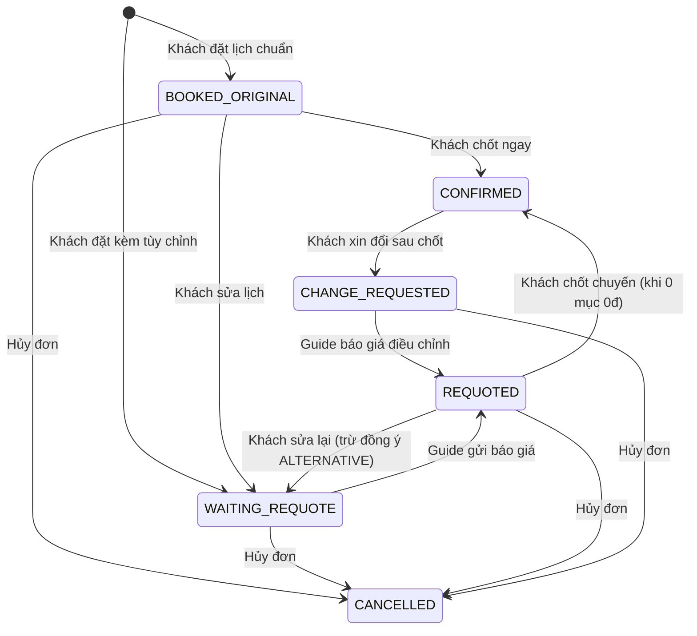

# BÁO CÁO KIỂM TOÁN TOÀN DIỆN (PRODUCTION AUDIT) & LỘ TRÌNH PHÁT TRIỂN — DỰ ÁN TRIPBUILDER

> **Vai trò thực hiện:** Principal Software Project Manager (20 năm kinh nghiệm)  
> **Đối tượng kiểm toán:** Hệ thống **TripBuilder** (`d:\2026.1\Project1_demo`) — Kiến trúc 1 Backend + 3 Frontend  
> **Chế độ kiểm toán:** **Zero-Tolerance Policy · Evidence-Based Only · Zero Source-Code Modification** (Chưa chỉnh sửa bất kỳ file mã nguồn nào; toàn bộ kết luận dựa trên đọc code trực tiếp, chạy server sống `:8080`, `:5173`, `:5174`, `:5175`, bắn API thực nghiệm và kiểm chứng bằng Browser Subagent).

---

## GIAI ĐOẠN 1: KHẢO SÁT HIỆN TRẠNG (RECONNAISSANCE)

### 1.1. Bản đồ Kiến trúc & Tech Stack

```mermaid
flowchart LR
    C["Client Portal (:5173)\nReact 19 + Vite + TanStack Query\nZustand + Tailwind v4 + Astryx"] -->|Bearer Token (CUSTOMER)| API["TripBuilder-backend (:8080)\nSpring Boot 4.1.1 + Java 17\nSpring Data JPA + Hibernate 7.4.5"]
    G["Guide Portal (:5174)\nReact 19 + Vite + TanStack Query\nZustand + Tailwind v4 + Astryx"] -->|Bearer Token (GUIDE)| API
    A["Admin Portal (:5175)\nReact 19 + Vite + TanStack Query\nZustand + Tailwind v4 + Astryx"] -->|Bearer Token (ADMIN)| API
    API -->|Profile h2 / MSSQL| DB[("H2 File/Mem DB\n7 Entities, 7 Repositories")]
    API -->|/images/** Static| MEDIA["78 ảnh cục bộ\n(activities, avatars, 6 vùng)"]
```

| Thành phần | Thư mục | Cổng | Công nghệ chính | Trạng thái chạy thực tế |
| :--- | :--- | :---: | :--- | :--- |
| **Backend API** | `TripBuilder-backend` | `:8080` | Spring Boot 4.1.1, Java 17, JPA/Hibernate 7.4.5, H2/SQL Server | **CRASH** trên `data/tripbuilder.mv.db` cũ do lỗi H2 ENUM `ADMIN`; chạy được trên H2 sạch |
| **Cổng Khách hàng** | `TripBuilder-frontend-client` | `:5173` | React + Vite 8.3.4, TanStack Query, Zustand, `@astryxdesign/core` | Chạy ổn định, không có URL Router (state-based navigation) |
| **Cổng Tour Guide** | `TripBuilder-frontend-guide` | `:5174` | React + Vite 8.3.4, TanStack Query, Zustand, `@astryxdesign/core` | Chạy ổn định, navbar bị tràn ngang ở `1280×800` |
| **Cổng Admin Tổng** | `TripBuilder-frontend-admin` | `:5175` | React + Vite 8.3.4, TanStack Query, Zustand, `@astryxdesign/core` | Chạy ổn định, thiếu nhiều API quản trị & vi phạm `unslop` |

---

### 1.2. Danh sách Trang / View (Client-side State Routing)

Cả 3 Frontend **không sử dụng `react-router-dom` hay History API** — mọi màn hình đều render có điều kiện tại `/` thông qua state trong Zustand (`useClientUiStore`, `useGuideUiStore`, `useAdminUiStore`).

1. **Client Portal (`:5173`)**:
   - `views/auth/LoginPage.tsx` (Tab `Đăng nhập` + Tab `Đăng ký tài khoản mới` + `Chọn nhanh 1 chạm · Khách mẫu`)
   - `App.tsx` — Tab `Khám phá` (`explore`): Hero + Toolbar lọc vùng/thời lượng/giá/tìm kiếm + Region Lookbook + Lưới Tour
   - `App.tsx` — Tab `Đã lưu` (`saved`): Danh sách tour yêu thích
   - `App.tsx` — Tab `Chuyến của tôi` (`trips`): Danh sách hồ sơ đặt tour
   - `views/tours/TourDetailView.tsx`: Chi tiết tour 5-photo bento + lịch trình theo ngày + Sticky Concierge Box
   - `views/bookings/CustomerCustomizeModal.tsx`: Modal tùy chỉnh ngày/khách/hình thức/từng chặng & đặt tour
   - `views/bookings/BookingWorkspace.tsx`: Hồ sơ chi tiết đơn, bảng đối chiếu tài chính 4 cột, stepper 4 chặng, nhật ký, đánh giá
   - `components/ui/TravelPhotoLightbox.tsx`: Trình xem ảnh toàn màn hình
2. **Guide Portal (`:5174`)**:
   - `views/auth/LoginPage.tsx` (Chọn nhanh 3 Guide mẫu + Form đăng nhập)
   - `App.tsx` — Tab `Tổng quan` (`overview`): Dải tóm tắt bất đối xứng 5+7 + Hàng đợi hồ sơ
   - `App.tsx` — Tab `Đơn đặt & Báo giá` (`bookings`): Bộ lọc trạng thái + tìm kiếm + danh sách hồ sơ + Drawer `Xem nhanh`
   - `App.tsx` — Tab `Tour mẫu` (`tours`): Lưới quản lý tour mẫu của Guide
   - `views/tours/GuidePresetEditor.tsx`: Modal tạo/sửa tour mẫu kèm `RegionPhotoPicker`
   - `views/bookings/BookingRequoteWorkspace.tsx`: Màn hình báo giá từng dòng, ưu đãi/phụ thu đoàn, nhật ký
3. **Admin Portal (`:5175`)**:
   - `views/auth/LoginPage.tsx` (Giao diện nền tối `#0F172A` lệch tông + 2 Admin mẫu + Form đăng nhập)
   - `views/admin/OverviewView.tsx`: 9 thẻ KPI toàn sàn
   - `views/admin/UsersView.tsx`: Bảng User + bộ lọc vai trò + Modal `Thêm Tour Guide mới`
   - `views/admin/OperationsView.tsx`: Sub-tab `Tất cả Đơn đặt` & `Tất cả Tour mẫu`
   - `views/admin/CatalogView.tsx`: Bộ lọc 6 vùng + Bảng `PresetOption` + Modal `Thêm dịch vụ vào kho`

---

### 1.3. Danh sách toàn bộ 25 API Endpoints hiện có (`TripBuilder-backend`)

| Nhóm | Method & Path | Controller | AuthN / AuthZ |
| :--- | :--- | :--- | :--- |
| **System** | `GET /api/hello` | `HelloController` | Public (rò rỉ DB metadata) |
| **Auth** | `POST /api/auth/login` | `AuthController` | Public (kiểm tra `expectedRole`) |
| **Auth** | `POST /api/auth/register` | `AuthController` | Public (tạo `CUSTOMER`) |
| **Auth** | `GET /api/auth/me` | `AuthController` | Authenticated |
| **Auth** | `GET /api/auth/demo-accounts?role=` | `AuthController` | Public (lộ toàn bộ user theo role!) |
| **Users** | `GET /api/users?role=` | `UserController` | Authenticated (chỉ đọc demo list — **Dead API**) |
| **Regions** | `GET /api/regions` | `RegionController` | Public |
| **Regions** | `GET /api/regions/{id}/photos` | `RegionController` | Public |
| **Regions** | `GET /api/regions/photos` | `RegionController` | Public |
| **Options** | `GET /api/options?regionId=` | `PresetOptionController` | Public |
| **Tours** | `GET /api/tours` | `TourController` | Public |
| **Tours** | `GET /api/tours/{id}` | `TourController` | Public |
| **Tours** | `POST /api/tours` | `TourController` | `GUIDE` |
| **Tours** | `PUT /api/tours/{id}` | `TourController` | `GUIDE` (chủ sở hữu) |
| **Favorites** | `GET /api/favorites` | `FavoriteController` | `CUSTOMER` |
| **Favorites** | `POST /api/favorites/{tourId}` | `FavoriteController` | `CUSTOMER` |
| **Favorites** | `DELETE /api/favorites/{tourId}` | `FavoriteController` | `CUSTOMER` |
| **Bookings** | `GET /api/bookings` | `BookingController` | `CUSTOMER` / `GUIDE` (**hỏng với `ADMIN`**) |
| **Bookings** | `GET /api/bookings/{id}` | `BookingController` | `CUSTOMER` / `GUIDE` sở hữu (**chặn `ADMIN`**) |
| **Bookings** | `POST /api/bookings` | `BookingController` | `CUSTOMER` |
| **Bookings** | `PUT /api/bookings/{id}/customize` | `BookingController` | `CUSTOMER` sở hữu |
| **Bookings** | `PUT /api/bookings/{id}/requote` | `BookingController` | `GUIDE` sở hữu |
| **Bookings** | `POST /api/bookings/{id}/confirm` | `BookingController` | `CUSTOMER` sở hữu |
| **Bookings** | `POST /api/bookings/{id}/cancel` | `BookingController` | `CUSTOMER` / `GUIDE` sở hữu (**chặn `ADMIN`**) |
| **Bookings** | `POST /api/bookings/{id}/review` | `BookingController` | `CUSTOMER` sở hữu |
| **Admin** | `GET /api/admin/overview`, `/users`, `POST /users`, `/tours`, `/bookings`, `/preset-options`, `POST /preset-options`, `DELETE /preset-options/{id}` | `AdminController` | `ADMIN` (8 endpoints) |

### 1.4. Luồng nghiệp vụ cốt lõi (Core User Flows)



---

## GIAI ĐOẠN 2: BÁO CÁO ĐỘC LẬP CỦA CÁC SUBAGENT

### 2.1. Subagent FE-Lead: Chuyên gia Frontend & Thanh trừng "AI Slop" / "Zero Dead-UI"

#### A. Đánh giá theo Skill `unslop` (9 Passes)
- **Điểm làm tốt (Client & Guide):** Đã loại bỏ gradient lòe loẹt, emoji trong UI, dùng `tabular-nums` (`.num`), 1 màu nhấn `--accent: #D9381E`, line icons thống nhất (`IconBase`).
- **Điểm vi phạm `unslop` nghiêm trọng (tập trung ở Admin `:5175` và rải rác ở Client/Guide):**
  1. **Lệch tông màu & Slop trên Admin Login (`TripBuilder-frontend-admin/src/views/auth/LoginPage.tsx#L32-L210`):** Dùng nền xanh đen `#0F172A`, thẻ `#161F33`, `shadow-2xl`, pill badge đỏ `"Quyền hạn ADMIN"`, dòng footer `"Port :5175"` và thuật ngữ kỹ thuật `PresetOption` — hoàn toàn lạc lõng so với Dashboard nền sáng `#FAFAFA` ngay sau khi đăng nhập.
  2. **9 thẻ KPI đồng kích thước + hộp màu trang trí (`TripBuilder-frontend-admin/src/views/admin/OverviewView.tsx#L43-L195`):** Vi phạm trực tiếp nguyên tắc `unslop` mục *Details* (`Vary the sizes. Cards of equal width side by side... read as a template` & `No icons added to fill them`). Toàn bộ 9 thẻ là `<div>` tĩnh, không thể click để drill-down sang danh sách đơn/user tương ứng.
  3. **Inversion Hierarchy trên Client Login (`TripBuilder-frontend-client/src/views/auth/LoginPage.tsx#L195-L274`):** Nút submit form chính `"Đăng nhập"` dùng class `btn-ghost` (chữ mờ, viền nhạt, bị đẩy xuống dưới màn hình ở `y = 855px`), trong khi 5 nút Demo lại dùng `btn-primary` rực rỡ chiếm toàn bộ phần trên màn hình.
  4. **Copy sai sự thật & Dữ liệu fallback giả:**
     - `TripBuilder-frontend-client/src/App.tsx#L419`: Khẳng định cứng `"Lữ hành bản địa Việt Nam · 78 tư liệu ảnh thực tế"`, trong khi `DataSeeder.java#L471` chỉ seed **72 ảnh** trong `region_photos` (66 ảnh vùng + 6 ảnh activities).
     - `TripBuilder-frontend-client/src/App.tsx#L233`, `TourDetailView.tsx#L154`, `BookingWorkspace.tsx#L253`: Dùng fallback giả `tour.guide.yearsExperience || 5`, khiến mọi Guide mới tạo bởi Admin (vốn chưa có input nhập số năm kinh nghiệm) tự động biến thành `"5 năm kinh nghiệm"`.
  5. **Badge/Text kỹ thuật rò rỉ ra giao diện người dùng:** `ADMIN` viết hoa (`TripBuilder-frontend-admin/src/App.tsx#L147`), `PresetOption` trong copy (`CatalogView.tsx#L52`), mã `HOTEL`, `FOOD`, `TRANSPORT`, `ACTIVITY` thô lọt ra dropdown (`CatalogView.tsx#L216`) và tag trong modal Client/Guide.
  6. **Layout vỡ ở độ phân giải Laptop `1280×800` (Browser Subagent xác nhận):**
     - `TripBuilder-frontend-guide/src/App.tsx#L254-L304`: Thanh nav bị cắt chữ `"Đơn đặt & Báo giá"` và đẩy `"Tour mẫu 2"` ra ngoài viewport ngang.
     - `TripBuilder-frontend-admin/src/views/admin/OperationsView.tsx#L166-L214`: Bảng `"Tất cả Tour mẫu"` bị cắt ngang cột `"Giá gốc / người"` bên phải.

#### B. Chiến dịch "Zero Dead-UI" & Trải nghiệm 4 Trạng thái (Loading / Empty / Error / Success)
- **Dead / Passive UI phát hiện được:**
  - `OverviewView.tsx` (Admin): 9 thẻ KPI không có hành động click/filter.
  - `UsersView.tsx` (Admin): Bảng người dùng hoàn toàn chỉ đọc (không có Sửa/Khóa/Xóa); Modal tạo Guide thiếu trường `yearsExperience`, `bio`, `avatarUrl`.
  - `OperationsView.tsx` (Admin): Bảng Đơn đặt & Tour mẫu chỉ đọc, không click mở chi tiết hay hủy đơn.
  - `CatalogView.tsx` (Admin): Nút `"Xoá"` (`#L142-L152`) xóa thẳng DB không có hộp thoại xác nhận (Browser Subagent đã chứng minh xóa `#44` ngay lập tức chỉ với 1 click).
  - **Thiếu URL Routing trên cả 3 cổng:** Browser Subagent bấm nút `Back` của trình duyệt khi đang ở `BookingWorkspace` (`BK-0006`) hoặc `TourDetailView` thì trình duyệt không quay lại danh sách mà giữ nguyên màn hình hoặc thoát khỏi app.
- **Đánh giá 4 Trạng thái (Loading — Empty — Error — Success):**
  - *Client & Guide:* Có `loadingData`, `empty state`, `error banner`, tuy nhiên **thiếu Toast/Feedback thành công** khi tạo/cập nhật/chốt đơn nếu không chuyển màn hình, và **thiếu Error Boundary** ở `main.tsx` (nếu render crash sẽ trắng trang).
  - *Admin:* `OverviewView.tsx#L41` dùng `const data = overview!;` (non-null assertion nguy hiểm nếu query reset); các mutation xóa/tạo không có xác nhận hoặc toast.

---

### 2.2. Subagent BE-Architect: Kiến trúc sư Backend & Đối chiếu 1-1 FE-BE

#### A. Điểm mạnh kiến trúc hiện có
- Tổ chức **Layered Architecture** rõ ràng (`controller`, `service`, `repository`, `entity`, `dto`, `security`, `exception`).
- **Bảo mật giá & Snapshot xuất sắc ở tầng nghiệp vụ:** `BookingService.buildPriceLookup()` & `resolveCustomerStep()` không tin tưởng giá Client gửi lên mà tra cứu lại từ `TourStep`, `PresetOption` và báo giá cũ của Guide; `Booking` lưu `tourTitleSnapshot`, `tourVersionSnapshot` nên Guide sửa Tour lên `v2` không làm hỏng đơn `v1`.

#### B. Lỗ hổng Kiến trúc, Đồng bộ FE-BE & API Dư/Thiếu
1. **Lỗi Crash DB khi khởi động lại (`P0`):** `AppUser.java#L26-L28` thiếu `@JdbcTypeCode(SqlTypes.VARCHAR)` (trong khi `Booking.java#L94` có) và `DataSeeder.migrateColumns()` không migrate `app_users.role`. Khi chạy trên H2 file cũ (`data/tripbuilder.mv.db`), Hibernate giữ cột `ENUM('CUSTOMER', 'GUIDE')` và sập ngay khi seed `Role.ADMIN`.
2. **Đứt gãy hợp đồng dữ liệu `PresetOption.category` (`P0`):** Admin (`CatalogView.tsx`) gửi `"HOTEL"`, `"FOOD"`, `"TRANSPORT"`, `"ACTIVITY"`, còn DB mẫu (`DataSeeder.java#L700-L748`), Client (`CustomerCustomizeModal.tsx#L335,L629`) và Guide (`BookingRequoteWorkspace.tsx#L345`) lọc cứng theo `"Khách sạn"`, `"Ăn uống"`, `"Di chuyển"`, `"Trải nghiệm"`. Hệ quả: mọi dịch vụ Admin tạo mới đều biến mất khỏi mục `"Đổi lựa chọn"` của Khách và Guide!
3. **Admin bị mù & bị chặn trên `BookingController` (`P0`):**
   - `BookingController.java#L38-L41` không có nhánh `if (user.getRole() == Role.ADMIN)`, nên mặc định coi `ADMIN` như `GUIDE` (`bookingService.list(null, adminId)` -> trả về `[]`).
   - `BookingService.canView()` (`#L383-L385`) chỉ cho `customer` hoặc `guide`, nên Admin gọi `GET /api/bookings/{id}` hoặc `POST /api/bookings/{id}/cancel` bị ném `403 Forbidden`.
4. **API dư thừa (Dead Endpoint):** `UserController.java` (`GET /api/users?role=`) trùng hoàn toàn với `AuthController.listDemoAccounts()` (`/api/auth/demo-accounts?role=`) và không được bất kỳ Frontend nào gọi.
5. **Thiếu API Production cho 3 cổng:**
   - **Admin:** Thiếu `PUT /api/admin/users/{id}` (sửa thông tin/vùng/khóa tài khoản), `PUT /api/admin/preset-options/{id}` (sửa dịch vụ kho vùng), `GET /api/admin/bookings/{id}` & `POST /api/admin/bookings/{id}/cancel` (Admin xem chi tiết & can thiệp sự cố).
   - **Guide:** Thiếu `DELETE /api/tours/{id}` hoặc `PATCH /api/tours/{id}/archive` (ẩn/xóa tour mẫu nháp hoặc ngừng kinh doanh).
   - **Client:** Thiếu kiểm tra `Tour.guide` không được tự đặt tour của chính mình (nếu đổi role) và thiếu Idempotency Key chống đặt trùng đơn.

---

### 2.3. Subagent QA-Breaker: Chuyên gia Kiểm thử & Phá hoại (Bằng chứng Sống)

Toàn bộ 12 kịch bản kiểm thử thực nghiệm đã được bắn trực tiếp vào Backend `http://localhost:8080` và kiểm chứng trên 3 cổng Frontend:

| # | Kịch bản tấn công (Payload / Hành động) | Kết quả thực tế (Status + Response / UI) | Mức độ |
| :-: | :--- | :--- | :-: |
| **0** | Khởi động Backend với file H2 cũ (`data/tripbuilder.mv.db`) | **CRASH STARTUP (Exit code 1)**: `JdbcSQLDataException: Value not permitted for column "('CUSTOMER', 'GUIDE')": "ADMIN"` | **P0** |
| **1** | `POST /api/auth/login` với body rỗng hoặc `expectedRole: "INVALID_ROLE"` | **HTTP 500**: `{"statusCode":500,"message":"Lỗi hệ thống nội bộ, vui lòng thử lại sau","data":null}` (lẽ ra `400`) | **P0** |
| **2** | `GET /api/options` hoặc `GET /api/auth/demo-accounts` thiếu query param | **HTTP 500**: `{"statusCode":500,"message":"Lỗi hệ thống nội bộ, vui lòng thử lại sau","data":null}` (lẽ ra `400`) | **P1** |
| **3** | `POST /api/tours` với `"steps": [null]` | **HTTP 500** (`NullPointerException` tại `TourService.java#L165`) | **P0** |
| **4** | `POST /api/bookings/4/review` với `review` dài 1.200 ký tự (`> 1000`) | **HTTP 500** (`DataIntegrityViolationException` vì DB `length = 1000`, BE không validate) | **P0** |
| **5** | `POST /api/auth/register` tạo khách thật (`khach.that.99@gmail.com`), sau đó mở Login / gọi `/api/auth/demo-accounts?role=CUSTOMER` | **HTTP 200** — Lộ công khai email & tên khách thật lên màn Login `:5173` mục `"Khách mẫu (Mật khẩu: 123456)"` (Browser xác nhận hiển thị `04 · Khach That Test`) | **P0** |
| **6** | `POST /api/auth/register` với `email: "abc"`, `password: "1"` | **HTTP 200** — Tạo thành công user `id: 10`, cấp token hợp lệ cho email rác & mật khẩu 1 ký tự | **P0** |
| **7** | Admin `POST /api/admin/preset-options` với `category: "HOTEL"` | **HTTP 200** (`id: 44`) — Bên `:5173` vào `"Đổi lựa chọn"` của Khách sạn thì **mất tích**; lọc `"Tất cả"` thì hiện badge thô `"HOTEL"` | **P0** |
| **8** | Admin gọi `GET /api/bookings` và `GET /api/bookings/1` | `GET /api/bookings` trả `200` `{"data":[]}` (sai dữ liệu); `GET /api/bookings/1` trả **HTTP 403** `"Bạn không có quyền xem đơn đặt tour này"` | **P1** |
| **9** | `POST /api/bookings/4/review` với `{"rating": -999}` | **HTTP 200** — Tự động ép thành `"customerRating": 1` thay vì từ chối `400 Bad Request` | **P1** |
| **10** | Bắn liên tiếp 2 request `POST /api/bookings` giống hệt nhau | **HTTP 200 × 2** — Tạo trùng 2 đơn `BK-0005` và `BK-0006` (tổng 11.200.000đ) | **P1** |
| **11** | Không token (`GET /api/bookings`), IDOR (`An` xem đơn `2` của `Hoa`), RBAC (`CUSTOMER` gọi `/api/admin/users`) | **HTTP 401**, **HTTP 403**, **HTTP 403** — Cơ chế AuthInterceptor & RBAC hoạt động chuẩn | **PASS** |
| **12** | `GET /api/hello` không cần token | **HTTP 200** — Lộ `databaseProduct: "H2"`, `databaseVersion: "2.4.240"`, `databaseName: "TRIPBUILDER_AUDIT"` & emoji `👋` | **P2** |

---

## GIAI ĐOẠN 3: PHIÊN TRANH BIỆN KỸ THUẬT (BACKEND DEBATE)

### Vòng 1 — QA-Breaker Tấn công
> *"Hệ thống nhìn bề ngoài chạy mượt trên happy-path, nhưng khi đưa ra thương mại sẽ sập ngay ở 4 điểm:*
> 1. *Database cũ nâng cấp lên bản mới là chết ngay từ lúc boot (`JdbcSQLDataException` ở `AppUser.role`).*
> 2. *Mọi lỗi đầu vào phổ thông (JSON rỗng, sai enum `Role`, thiếu query param, mảng `steps` chứa `null`, chuỗi `> 1000` ký tự) đều ném **HTTP 500** vì `GlobalExceptionHandler` chỉ bắt 3 custom exception.*
> 3. *Cổng Khách hàng lộ toàn bộ khách hàng thật vừa đăng ký ra màn hình Login công khai cho bất kỳ ai xem (`AuthService.listDemoAccounts`), đồng thời cho phép đăng ký email `'abc'` mật khẩu `'1'`.*
> 4. *Admin tạo dịch vụ `HOTEL` thì Client và Guide không bao giờ nhìn thấy trong luồng đổi dịch vụ (`Khách sạn`).*
> *Chưa kể Admin gọi `/api/bookings/1` bị `403`, đánh giá `-999` sao vẫn nhận `200`, và double-submit tạo 2 đơn trùng lặp!"*

### Vòng 2 — BE-Architect Phản hồi & Giải trình
> *"Tôi thừa nhận toàn bộ các lỗ hổng trên là có thật qua kiểm chứng code và log:*
> - **Về phần đã làm tốt (Cơ chế bảo vệ hiện có):** Hệ thống đã chặn được IDOR và leo thang đặc quyền (`Test 11`: `401`, `403`, `403` chính xác). Tầng `BookingService.buildPriceLookup()` cũng đã tính lại 100% giá từ DB, không tin đơn giá từ Client gửi lên.
> - **Root Cause & Phương án sửa code cụ thể:**
>   1. **Startup crash (`AppUser.java`):** Thiếu `@JdbcTypeCode(SqlTypes.VARCHAR)` như đã làm ở `Booking.java#L94`. Cần thêm annotation này và bổ sung `ALTER TABLE app_users ALTER COLUMN role VARCHAR(20)` vào `DataSeeder.migrateColumns()`.
>   2. **Bão HTTP 500 (`GlobalExceptionHandler.java`):** Cần bổ sung `@ExceptionHandler` cho `HttpMessageNotReadableException`, `MissingServletRequestParameterException`, `MethodArgumentTypeMismatchException`, `MethodArgumentNotValidException` trả về `400 Bad Request`; thêm `@Valid` + Bean Validation (`@NotBlank`, `@Email`, `@Size(max=1000)`, `@Min(1) @Max(5)`) cho toàn bộ Request DTO; lọc `s == null` trong `TourService` và `BookingService`.
>   3. **Lộ tài khoản thật (`AuthService.java#L93-L97`):** Cần thêm cờ `boolean isDemo` (hoặc chỉ lọc theo danh sách email demo cố định / chỉ bật endpoint `/api/auth/demo-accounts` khi `app.demo.enabled=true`). Tuyệt đối không trả toàn bộ `findByRoleOrderByIdAsc` ra public.
>   4. **Lệch `PresetOption.category` (`AdminService.java` & `CatalogView.tsx`):** Chuẩn hóa 1 bộ giá trị duy nhất (lưu tiếng Việt chuẩn `"Khách sạn"`, `"Ăn uống"`, `"Di chuyển"`, `"Trải nghiệm"` hoặc chuẩn hóa enum + mapper 2 chiều ở Backend trước khi lưu/trả về).
>   5. **Admin Booking & Race Condition:** Sửa `BookingController` & `BookingService.canView()` để `Role.ADMIN` xem được tất cả đơn; thêm `@Version` trên `Booking` chống ghi đè đồng thời và `Idempotency-Key` hoặc kiểm tra trùng đơn gần nhất trong 10 giây ở `BookingService.create()`."*

### Vòng 3 — PM Chốt hạ (Verdict)
PM đóng băng **6 quyết định bắt buộc** trước khi cho phép triển khai Production:
1. **Khóa bảo mật Auth:** Tách biệt hoàn toàn tài khoản Demo (`isDemo = true` + config flag) khỏi tài khoản người dùng thật; ép validate Email RFC & Password `>= 6` ký tự ở cả BE lẫn FE.
2. **Chuẩn hóa Error Handling:** Mọi input sai từ Client phải trả `400 Bad Request` với message tiếng Việt rõ ràng; nghiêm cấm trả `500` cho lỗi validation/parsing.
3. **Đồng nhất hợp đồng Category:** Backend là nguồn chân lý (Single Source of Truth) cho 4 danh mục chuẩn; không để Admin lưu `HOTEL` trong khi Client/Guide lọc `"Khách sạn"`.
4. **Mở khóa quyền Admin & Xác nhận thao tác phá hủy:** Admin xem được chi tiết Booking/Tour, sửa User, sửa PresetOption; mọi nút Xóa phải có Confirmation Dialog.
5. **Hoàn thiện URL Routing & Unslop:** Đưa `react-router-dom` (hoặc đồng bộ URL query/path) vào 3 cổng để nút Back hoạt động tự nhiên; đồng bộ giao diện Admin Login và dọn sạch passive KPI cards / copy sai số lượng ảnh.
6. **Xóa Dead Code:** Gỡ bỏ `UserController.java` (`/api/users`) và các CSS legacy alias không dùng nếu không phục vụ tương thích.

---

## GIAI ĐOẠN 4: TỔNG HỢP BÁO CÁO & LỘ TRÌNH TRIỂN KHAI CHO NHÂN VIÊN

### Phần 1: Đánh giá Tổng quan của PM (Executive Verdict)

- **Production Readiness Score: `6.2 / 10`**
  - *Nhận xét thẳng thắn:* Dự án có phần **nghiệp vụ lõi (Business Logic) khá sáng** — đặc biệt là cơ chế Snapshot Tour Version và PriceLookup chống gian lận giá. Giao diện Client (`:5173`) và Guide (`:5174`) đã được làm khá sạch theo `unslop`. Tuy nhiên, **hệ thống chưa đạt chuẩn Production thương mại** vì thiếu lớp Validation/Exception Handling cơ bản (rất dễ văng `500`), dính lỗi bảo mật nghiêm trọng ở màn Login (lộ khách hàng thật), đứt gãy dữ liệu giữa Admin và Client/Guide, và Cổng Admin (`:5175`) vẫn còn nhiều màn hình tĩnh/lệch chuẩn thiết kế.

- **3 Rủi ro lớn nhất có thể làm dự án thất bại ngay khi Go-Live:**
  1. **Rủi ro Bảo mật & Riêng tư (P0):** Bất kỳ ai mở `http://localhost:5173` đều thấy danh sách email & họ tên của toàn bộ khách hàng thật đã đăng ký trên sàn (`GET /api/auth/demo-accounts?role=CUSTOMER`), kèm nút bấm thử đăng nhập 1-chạm.
  2. **Rủi ro Sập DB & Lỗi 500 dây chuyền (P0):** Backend sập ngay khi khởi động trên DB có dữ liệu cũ (`AppUser.role` ENUM), và trả về `500 Internal Server Error` cho các lỗi nhập liệu thông thường (thiếu param, JSON lỗi, note > 1000 ký tự, `steps` chứa `null`).
  3. **Rủi ro Đứt gãy vận hành Admin — Client/Guide (P0):** Dịch vụ mới do Admin thêm (`HOTEL`, `FOOD`...) bị tàng hình trong modal đổi dịch vụ của Khách và Guide; Admin không thể xem chi tiết đơn, không sửa được User/Dịch vụ, và có thể xóa nhầm dữ liệu kho chỉ bằng 1 cú click không xác nhận.

---

### Phần 2: Báo cáo Chi tiết từng Mảng

#### 2.1. Bảng Thanh trừng AI Slop & Zero Dead-UI

| Component / File | Phần tử thừa / Slop / Lỗi UI | Hành động | Lý do cụ thể |
| :--- | :--- | :---: | :--- |
| `TripBuilder-frontend-admin/src/views/auth/LoginPage.tsx` | Nền tối `#0F172A`, `shadow-2xl`, badge `"Quyền hạn ADMIN"`, copy `"PresetOption"`, footer `"Port :5175"` | **SỬA** | Lạc tông hoàn toàn với Dashboard nền sáng `#FAFAFA`; chứa thuật ngữ kỹ thuật & badge kiểu AI template |
| `TripBuilder-frontend-admin/src/views/admin/OverviewView.tsx` | 9 thẻ KPI đồng kích thước kèm icon hộp màu trang trí, không click được | **SỬA** | Vi phạm `unslop` (equal-width cards + decorative icons); Dead UI — cần biến thành thẻ có hành động điều hướng/lọc sang tab tương ứng |
| `TripBuilder-frontend-client/src/views/auth/LoginPage.tsx#L270` | Nút submit `"Đăng nhập"` dùng `btn-ghost` mờ nhạt, nằm dưới fold | **SỬA** | Đảo ngược phân cấp thị giác (nút demo nổi hơn nút chính). Đổi thành `btn-primary` |
| `TripBuilder-frontend-client/src/App.tsx#L419` | Copy `"78 tư liệu ảnh thực tế"` | **SỬA** | Sai sự thật (DB seed 72 ảnh trong `region_photos`); nên lấy động từ API hoặc bỏ con số cứng |
| `TripBuilder-frontend-client/src/App.tsx#L233` (và `TourDetailView`, `BookingWorkspace`) | Fallback giả `tour.guide.yearsExperience \|\| 5` | **SỬA** | Bịa đặt số năm kinh nghiệm cho Guide mới chưa có dữ liệu; chỉ hiển thị khi `yearsExperience != null` |
| `TripBuilder-frontend-guide/src/App.tsx#L254-L304` & `#L380,543` | Nav bị cắt ngang ở `1280px`; H1 trùng lặp ở `Tổng quan` và `Đơn đặt & Báo giá` | **SỬA** | Lỗi responsive desktop chuẩn; đặt H1 riêng cho từng tab để rõ ngữ cảnh |
| `TripBuilder-frontend-guide/src/hooks/useGuidePresetEditor.ts#L43` | Mặc định `regionId` là `regions[0]?.id` (Hạ Long) | **SỬA** | Guide Đà Lạt mở modal tạo tour bị chọn nhầm Hạ Long; đổi mặc định sang `user.regionId` |
| `TripBuilder-frontend-admin/src/views/admin/CatalogView.tsx#L142` | Nút `"Xoá"` xóa thẳng không hỏi xác nhận | **SỬA** | Nguy cơ mất dữ liệu Production chỉ với 1 click nhầm; thêm modal/inline confirm |
| `TripBuilder-frontend-admin/src/views/admin/OperationsView.tsx` & `UsersView.tsx` | Bảng chỉ đọc, không click xem chi tiết/sửa; bảng Tour mẫu bị cắt cột phải ở `1280px` | **NỐI API** | Thiếu thao tác quản trị thực tế và lỗi overflow bảng |
| `TripBuilder-frontend-client/src/App.tsx` (và Guide/Admin) | Thiếu URL routing (nút Back trình duyệt không hoạt động) | **SỬA** | Trải nghiệm web không chuẩn; tích hợp `react-router-dom` hoặc đồng bộ URL |

#### 2.2. Bảng Ma trận Đồng bộ FE-BE 1-1

| Nút bấm / Hành động trên FE | API Endpoint tương ứng | Trạng thái | Vấn đề & Cách xử lý |
| :--- | :--- | :---: | :--- |
| Client: Đăng nhập nhanh Khách mẫu (`LoginPage.tsx`) | `GET /api/auth/demo-accounts?role=CUSTOMER` | **LỖI BẢO MẬT** | Trả về cả khách hàng thật vừa đăng ký. Cần lọc `isDemo = true` & tắt khi lên Production |
| Client: Đăng ký tài khoản (`LoginPage.tsx`) | `POST /api/auth/register` | **THIẾU VALIDATE** | BE nhận email `"abc"`, pass `"1"`. Cần thêm `@Email`, `@Size(min=6)` |
| Client: Đặt tour & Tùy chỉnh (`CustomerCustomizeModal.tsx`) | `POST /api/bookings`, `PUT /api/bookings/{id}/customize` | **LỖI BIÊN** | Double-submit tạo trùng đơn; `steps: [null]` hoặc `note > 1000` gây `500`. Thêm validation & idempotency |
| Client: Đánh giá Guide (`BookingWorkspace.tsx`) | `POST /api/bookings/{id}/review` | **LỖI BIÊN** | `rating: -999` bị ép thành `1` sao và trả `200`; `review > 1000` gây `500`. Validate `1..5` & max `1000` |
| Client/Guide: Đổi dịch vụ từ kho vùng | `GET /api/options?regionId=` | **LỖI ĐỒNG BỘ** | Không hiển thị dịch vụ do Admin tạo (`HOTEL` vs `"Khách sạn"`). Chuẩn hóa category |
| Guide: Tạo/Sửa Tour mẫu (`GuidePresetEditor.tsx`) | `POST /api/tours`, `PUT /api/tours/{id}` | **LỖI BIÊN** | `steps: [null]` gây `500`; thiếu nút/API Xóa/Ẩn tour mẫu (`DELETE /api/tours/{id}`) |
| Admin: Thêm dịch vụ kho (`CatalogView.tsx`) | `POST /api/admin/preset-options` | **LỆCH CATEGORY** | Gửi `"HOTEL"` thay vì `"Khách sạn"`; thiếu nút/API Sửa (`PUT /api/admin/preset-options/{id}`) |
| Admin: Thêm Tour Guide (`UsersView.tsx`) | `POST /api/admin/users` | **THIẾU TRƯỜNG/API** | Form thiếu `yearsExperience`, `bio`; thiếu API Sửa/Khóa User (`PUT /api/admin/users/{id}`) |
| Admin: Xem chi tiết / Can thiệp đơn (`OperationsView.tsx`) | `GET /api/bookings/{id}`, `POST /api/bookings/{id}/cancel` | **LỖI PHÂN QUYỀN** | Backend trả `403` cho `ADMIN`; FE chưa có UI chi tiết đơn cho Admin |
| *(Không có nút FE)* | `GET /api/users?role=` (`UserController.java`) | **DEAD API** | Trùng `/api/auth/demo-accounts`, không FE nào gọi -> **XÓA** |

---

### Phần 3: Kế hoạch Phát triển & Lộ trình Triển khai (Actionable Roadmap & Task List Cuốn Chiếu)

#### Giai đoạn 1 — Dọn dẹp & Vá lỗ hổng chí mạng (P0 - Blocker)

- **P0-01: Fix Crash khởi động DB (`AppUser.role` ENUM)**
  - *Files:* `TripBuilder-backend/src/main/java/com/tripbuilder/entity/user/AppUser.java`, `TripBuilder-backend/src/main/java/com/tripbuilder/config/DataSeeder.java`
  - *Việc làm:* Thêm `@JdbcTypeCode(SqlTypes.VARCHAR)` lên `AppUser.role`; bổ sung DDL `ALTER TABLE app_users ALTER COLUMN role VARCHAR(20)` trong `DataSeeder.migrateColumns()`.
  - *DoD:* Backend khởi động thành công `0 error` kể cả khi chạy trên file DB cũ chỉ có `CUSTOMER`/`GUIDE`.

- **P0-02: Chặn lộ tài khoản khách hàng thật & siết Validate Auth**
  - *Files:* `TripBuilder-backend/src/main/java/com/tripbuilder/entity/user/AppUser.java`, `AuthService.java`, `dto/request/auth/RegisterRequest.java`, `dto/request/admin/CreateUserRequest.java`
  - *Việc làm:* Thêm trường `isDemo` (hoặc whitelist email mẫu) để `GET /api/auth/demo-accounts` không bao giờ trả về user đăng ký mới; thêm `@Email`, `@NotBlank`, `@Size(min = 6, max = 100)` cho `RegisterRequest` và `CreateUserRequest`.
  - *DoD:* Đăng ký tài khoản mới xong gọi `GET /api/auth/demo-accounts?role=CUSTOMER` không thấy tài khoản mới; gửi `email="abc"`, `password="1"` trả về `400 Bad Request`.

- **P0-03: Chuẩn hóa `GlobalExceptionHandler` & Validation toàn diện (Diệt lỗi HTTP 500)**
  - *Files:* `TripBuilder-backend/src/main/java/com/tripbuilder/exception/GlobalExceptionHandler.java`, `TourService.java`, `BookingService.java`, `dto/request/**`
  - *Việc làm:* Bắt `HttpMessageNotReadableException`, `MissingServletRequestParameterException`, `MethodArgumentTypeMismatchException`, `MethodArgumentNotValidException` -> trả `400`; kiểm tra `s == null` trong list `steps`; validate `rating` trong `1..5` (không silent clamp) và độ dài chuỗi (`<= 1000`).
  - *DoD:* Toàn bộ Test 1, 2, 3, 4, 9 trong bộ QA-Breaker trả về `400 Bad Request` với message rõ ràng, `0` lỗi `500`.

- **P0-04: Đồng nhất Category `PresetOption` giữa Admin và Client/Guide**
  - *Files:* `TripBuilder-backend/src/main/java/com/tripbuilder/service/admin/AdminService.java`, `TripBuilder-frontend-admin/src/config/constants/meta.ts`, `TripBuilder-frontend-admin/src/hooks/useCatalogManager.ts`
  - *Việc làm:* Map/lưu thống nhất 4 giá trị `"Khách sạn"`, `"Ăn uống"`, `"Di chuyển"`, `"Trải nghiệm"` (hoặc chuẩn hóa ở Backend trước khi lưu và validate enum hợp lệ).
  - *DoD:* Admin thêm dịch vụ mới -> hiển thị đúng nhóm tiếng Việt ở cả Client `CustomerCustomizeModal` (`Đổi lựa chọn`) và Guide `BookingRequoteWorkspace`.

- **P0-05: Mở quyền `ADMIN` trong `BookingController` & `BookingService`**
  - *Files:* `TripBuilder-backend/src/main/java/com/tripbuilder/controller/booking/BookingController.java`, `TripBuilder-backend/src/main/java/com/tripbuilder/service/booking/BookingService.java`
  - *Việc làm:* Cho phép `Role.ADMIN` gọi `GET /api/bookings`, `GET /api/bookings/{id}`, `POST /api/bookings/{id}/cancel`.
  - *DoD:* Admin token gọi `GET /api/bookings` trả đầy đủ đơn, `GET /api/bookings/1` trả `200 OK`.

---

#### Giai đoạn 2 — Hoàn thiện luồng nghiệp vụ & Đồng bộ FE-BE (P1 - Core Production)

- **P1-01: Bổ sung API Quản trị & Quản lý Tour còn thiếu**
  - *Files:* `AdminController.java`, `AdminService.java`, `TourController.java`, `TourService.java`, xóa `UserController.java`
  - *Việc làm:* Thêm `PUT /api/admin/users/{id}`, `PUT /api/admin/preset-options/{id}`, `DELETE /api/tours/{id}` (kiểm tra chưa có booking hoạt động hoặc soft-delete `archived`); xóa `UserController.java` dư thừa.
  - *DoD:* Test integration `mvn test` pass 100% cho các endpoint mới.

- **P1-02: Chống Double-Submit & Race Condition trên Booking**
  - *Files:* `Booking.java`, `BookingService.java`, `BookingController.java`
  - *Việc làm:* Thêm `@Version` optimistic locking trên `Booking`; thêm kiểm tra chống tạo trùng đơn giống hệt nhau trong cửa sổ ngắn (hoặc hỗ trợ header `Idempotency-Key`).
  - *DoD:* Bắn 2 request `POST /api/bookings` giống nhau liên tiếp không tạo 2 đơn trùng lặp ngoài ý muốn.

- **P1-03: Đồng bộ Giao diện & Nối API cho Admin Portal (`:5175`)**
  - *Files:* `TripBuilder-frontend-admin/src/views/auth/LoginPage.tsx`, `OverviewView.tsx`, `UsersView.tsx`, `OperationsView.tsx`, `CatalogView.tsx`
  - *Việc làm:* Thiết kế lại `LoginPage.tsx` đồng bộ palette sáng/xám của hệ thống (bỏ `shadow-2xl`, badge slop, `Port :5175`); nối click từ thẻ KPI sang tab chi tiết; thêm nút Sửa/Xóa/Chi tiết trên `UsersView`, `OperationsView`, `CatalogView` (có Modal xác nhận xóa); bổ sung `yearsExperience` và `bio` vào form tạo Guide.
  - *DoD:* 100% thẻ và nút trên Admin Portal hoạt động thật, không còn bảng bị cắt ngang ở `1280×800`.

- **P1-04: Sửa lỗi Logic & UX trên Client (`:5173`) và Guide (`:5174`)**
  - *Files:* `TripBuilder-frontend-client/src/views/auth/LoginPage.tsx`, `App.tsx`, `TripBuilder-frontend-guide/src/App.tsx`, `useGuidePresetEditor.ts`
  - *Việc làm:* Đổi nút submit Login Client sang `btn-primary`; sửa copy `"78 tư liệu ảnh"` thành dữ liệu động/chính xác; bỏ fallback `|| 5` năm kinh nghiệm; sửa default `regionId` trong `GuidePresetEditor` theo `user.regionId`; sửa navbar Guide không bị tràn ngang ở `1280px` và phân biệt H1 giữa các tab.
  - *DoD:* Browser Subagent kiểm tra lại không còn lỗi cắt chữ, sai số liệu, hay sai vùng mặc định.

- **P1-05: Tích hợp URL Routing (`react-router-dom`) cho cả 3 cổng**
  - *Files:* `App.tsx` và `main.tsx` của cả 3 Frontend
  - *Việc làm:* Ánh xạ các tab, chi tiết Tour (`/tours/:id`), chi tiết Booking (`/bookings/:id`) lên URL thật.
  - *DoD:* Bấm nút Back/Forward của trình duyệt hoặc F5 reload giữ đúng màn hình đang xem.

---

#### Giai đoạn 3 — Tối ưu hóa, Kiểm thử hồi quy & Chuẩn bị Go-Live (P2 - Polish & Hardening)

- **P2-01: Gỡ bỏ rò rỉ thông tin hạ tầng & emoji ở `/api/hello`**
  - *Files:* `TripBuilder-backend/src/main/java/com/tripbuilder/controller/system/HelloController.java`
  - *Việc làm:* Chỉ trả về `status: "UP"` và `serverTime` (ẩn tên DB, version DB, catalog name, bỏ emoji `👋`).
  - *DoD:* `GET /api/hello` không lộ thông tin DB nội bộ.

- **P2-02: Bổ sung Error Boundary & Toast Feedback đồng bộ trên 3 Frontend**
  - *Files:* `main.tsx` của 3 Frontend + component Toast dùng chung.
  - *DoD:* Lỗi render bất ngờ hiển thị màn hình fallback thân thiện thay vì trắng trang; mọi thao tác lưu/cập nhật có phản hồi rõ ràng.

- **P2-03: Mở rộng bộ Test tự động Hồi quy (Backend + Frontend Build)**
  - *Files:* `TripBuilder-backend/src/test/java/com/tripbuilder/AuthAndFlowTests.java`
  - *Việc làm:* Viết thêm test case cho 12 kịch bản QA-Breaker (negative cases, boundary length, category sync, admin booking access, double-submit).
  - *DoD:* Chạy `.\mvnw.cmd test` tại `TripBuilder-backend` và `npm run build` tại cả 3 Frontend đều đạt **100% PASS**.
